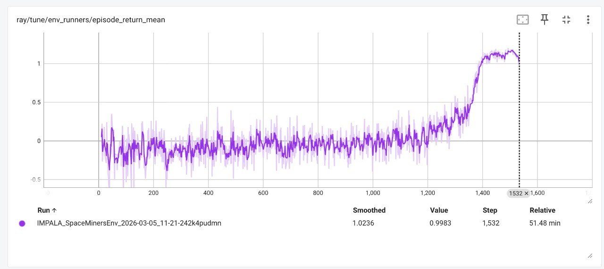
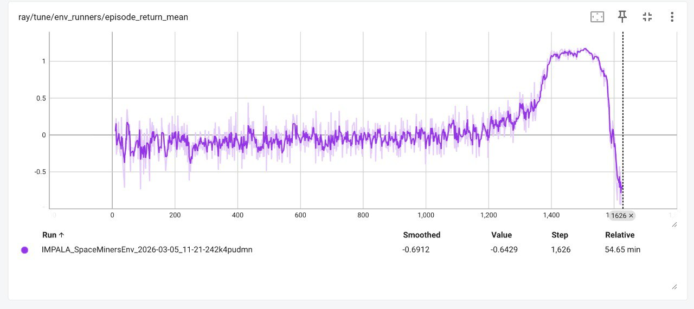
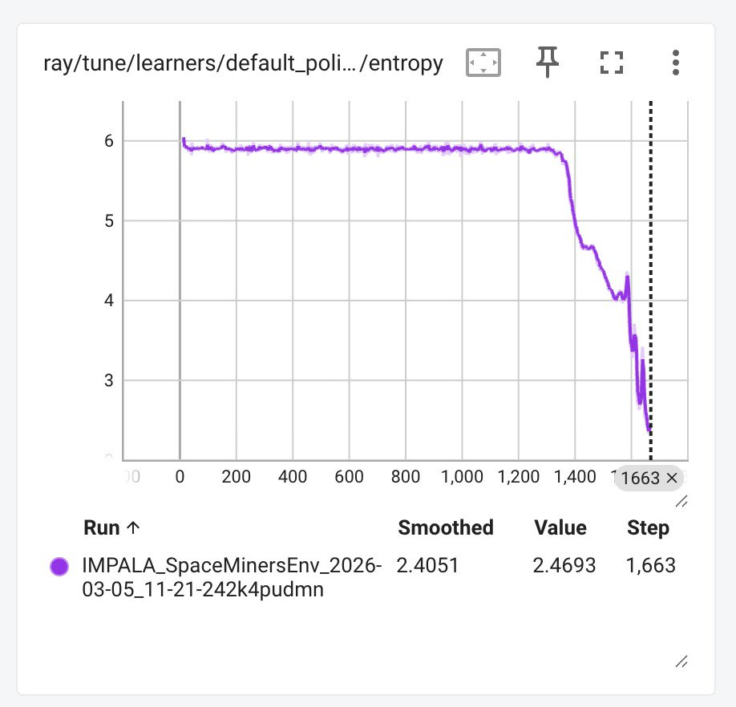
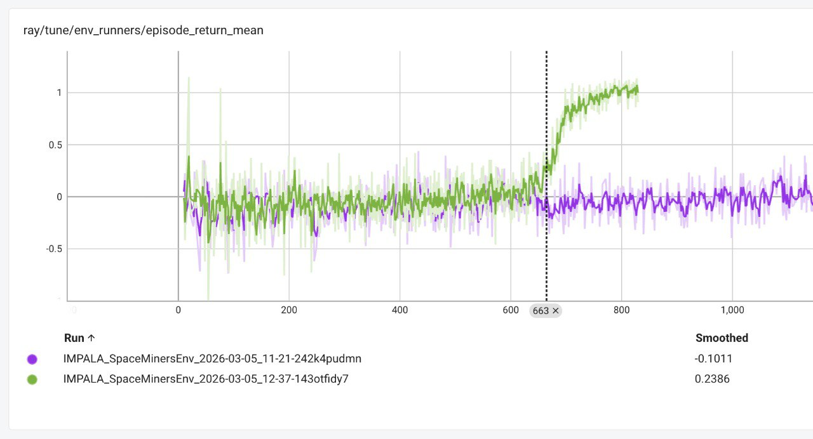
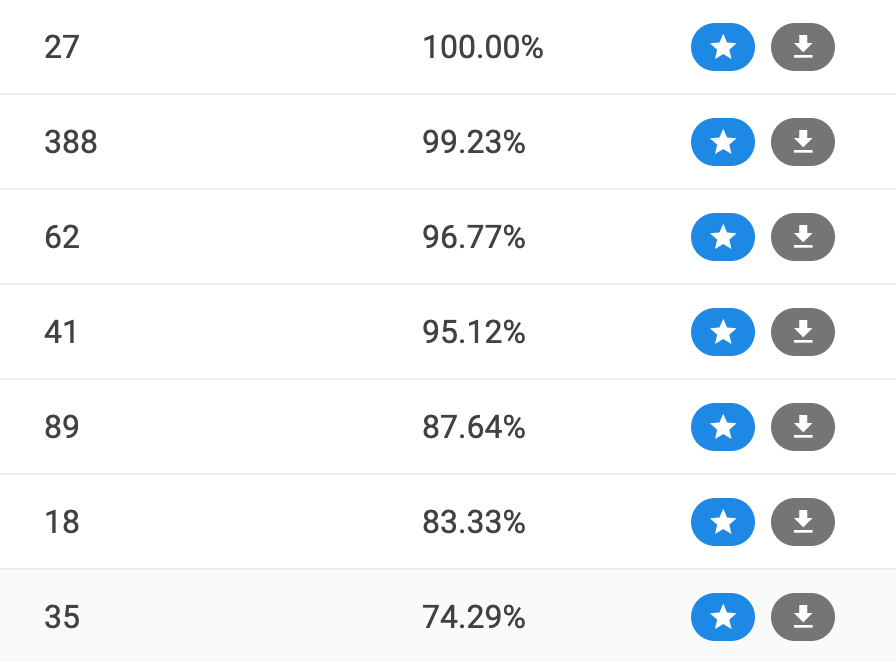
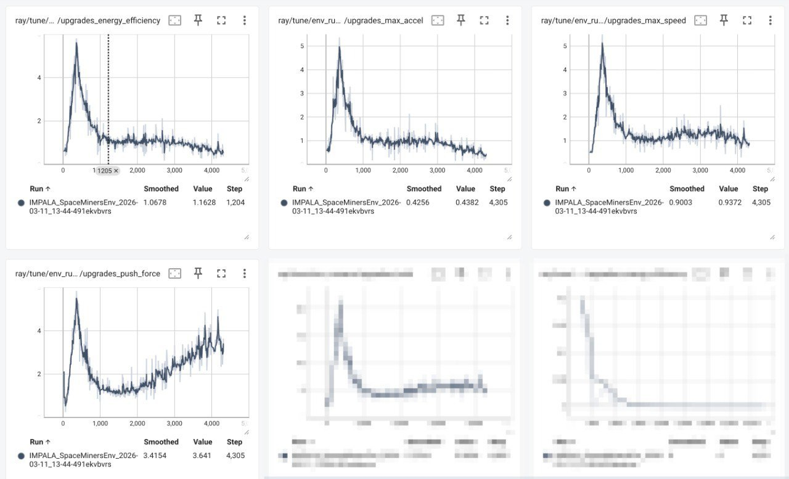

# Game AI Cup, core2duo, first place

From the start of the contest, I knew that I wanted to solve it using RL. To be honest, I didn't even care if I would not be able to submit or use my solution due to platform
limitations (submission size up to 2 MB, 256 MB RAM, 50ms per tick).

About my prior experience with RL: I know a lot of theory, starting from the book by Sutton and Barto, followed by a lot of RL-related papers, SotAs of their time like DQN and
its further improvements; PPO, R2D2, IMPALA, etc. I've also participated in [LuxAI](https://www.kaggle.com/competitions/lux-ai-2021/leaderboard) (14th place, silver) and [LuxAI Season 2](https://www.kaggle.com/competitions/lux-ai-season-2/leaderboard) (16th place, silver) contests on Kaggle.

I used [Ray RLlib](https://docs.ray.io/en/latest/rllib/index.html). Can definitely recommend, it helps you focus on the real task, not on polishing your infrastructure or RL algorithm itself (which can be really tricky). It was the first time I've used it and I spent quite a lot of time understanding its concepts and how to customize things and incorporate them into the framework.

Basically, for any algorithm to work, you need to create a `gymnasium.Env`-compatible environment from the local runner. You also need to provide observation and action formats.

## Hopelessness of trial and error
The problem with modern RL is - it is **really complicated**. If your agent does not learn anything, there could be tons of reasons:
* Is your RL algorithm good for the task?
* Did you choose the right observation encoding?
* Is your action space good?
* Is your model architecture good for the task?
* Does your model have enough capacity to learn the task (note the submit restrictions)?
* Are your hyperparameters right?
* Or maybe you just put a bug somewhere.
* Or maybe the creators of your RL lib put one somewhere.

And it's not that easy to differentiate one problem from another. Your algo just doesn't learn. I tried to overcome these issues for almost two weeks, so here I will describe that path.

I've started with:
1. PPO algorithm
2. Ego-centered state: for each ship, all observations were encoded in a way that the ship is always at (0, 0) and its velocity points in the +x direction. This way, each ship received its own view of a state, but it allowed calculating a rich set of features, including time-to-collision with any object.
3. Continuous actions: model outputs 4 scalars for each ship: mean (ax, ay) and standard deviation for (ax, ay). The latter part controls exploration and in an ideal world the agent should be able to learn when to explore and when to play precisely, setting the deviation component to (0, 0).
4. NN model architecture was simple - embeddings of all entities, attention from ships to all their ego-centric entities, concatenated with global features and then decoded into actions.
5. Normalized (divided by 20) reward for scoring asteroids, -reward for the opponent scoring. I played against a no-op opponent, so any opponent score is the agent's mistake.

And of course, it did not work. First of all, due to randomized initial weights, it's easier to accidentally score for the opponent, because if you just accelerate into asteroids, you will push them towards the enemy base. To push asteroids into your own base, you have to learn to fly over them and push them back. So, the agent gets a lot of negative rewards and quite fast it learns to just stay in place, because it's more rewarding than doing anything.
I've added a small negative reward for staying in place, but the agent learned to oscillate in a small neighborhood to still do nothing in global terms, while avoiding this penalty.

I should also note that looking at tensorboard charts alone does not give you a lot of clues until you really understand what to look for (and/or you create custom tensorboard charts with the needed info). I was looking at the `agent return` chart and it gave me some false hopes, but (I didn't know it yet!) it was just random walking - the agent was playing **absolutely randomly** while training. In eval (exploitation mode where we take only means for actions) the agent demonstrated stupid behavior - it was just randomly spinning, spamming only one action.

Until I've realized what's wrong exactly, I've tried a lot of things:
1. Changing algorithm to APPO (same PPO, but asynchronous and using V-trace to help with slightly off-policy rollouts), then changing it again to IMPALA. APPO is based on IMPALA, so
I've decided to switch to IMPALA to reduce algo's complexity and number of hyperparameters a little bit.
2. Changing action space to discrete actions. It removes the ability to take extremely precise actions from the agent, but heavily improves control over the actions the agent takes.
3. Changing model architecture a couple of times. Also, I've increased the number of model parameters greatly, up to 4 million, to make sure that the model has enough capacity to learn the task.
4. Simplifying observation encoding: getting rid of ego-centric encoding, just encoding the state in global space. This loses pairwise features (like time to collision, relative speed, bearing rate, etc), but simplifies and unifies features across game entities.

Yet, none of that worked out. The agent still demonstrated no sign of any intelligence. Also, I experimented a lot with surrogate rewards. I tried giving the agent rewards for simple tasks. For example, moving towards the enemy base gives a small reward, being inside the enemy base gives `+1` for every tick. Despite the uselessness of these rewards in the meaning of the game, it showed that the agent could learn a reward signal and understand the task of 'getting into the enemy base'. But even with this simple task, the agent did not learn to execute it optimally, often one or two ships were randomly oscillating somewhere instead of being on the enemy base and getting free reward.

At this time, I was feeling kinda hopeless. But I knew that there was one thing that should work. And this brings us to the next step.

## Behavior cloning
The idea behind behavior cloning (BC) is simple - you get a bunch of replays from other contestants and learn your policy distribution based on the data. Your Xs are game states from a player's perspective, your Ys are actions taken by that player. All replays of all games were available for download. Later, Roma (the creator of the contest) added a rate-limiter for replay downloading, which slowed things down a little bit, but BC was still an option.

Also, the game is great for augmenting: any state can be flipped along the Y-axis with almost no problems at all. And with some precise coding, it's possible to flip any state along the X-axis and both axes, effectively quadrupling the learning dataset.

So, I chose the top-10 players at that time and downloaded all replays with Round 1 preset where these players had won, up to five days of replay age. Then I used the same model and state encoding code as for RL. You learn the action distribution of all 10 players at once, so probably you cannot learn something better than their policies, but yet the agent can learn what to do.

BC worked great. The agent wasn't strong at all, but at least it showed the idea of what to do. It grabbed asteroids and pushed them towards its own base, scoring some winning points. I guess, the BC solution itself was good enough for the top-20, but what I really wanted was to fine-tune this BC with RL.

## Fine-tuning
The step "BC -> RL fine-tune" is quite hard. It's simple on paper, but reality differs. You need to learn a new policy distribution based on the previous one, and also you need to learn the state value function. Also, you want the agent to explore new opportunities to find a better way to play. And this simply won't work. Any unconstrained learning will collapse into oblivion in a few learning steps.

Also, this step asks a question - what reward should we use? It would be great to use the game reward - `+1`/`-1` for win/loss, but this reward is extremely sparse - the agent gets a reward signal once every 1000 ticks. Given a rollout length of 5, 10 or 20, you will get a real reward once in 200, 100 or 50 rollouts, meaning that the rest of the time you will be learning on your _representation_ of reward - your learned V function.

Again, I've tried a lot there. I will not write the full list of what I've tried, because it's getting long, but the most important things I've done among others are:
1. Limit environment to 250 ticks. Basically it speeds up games 4x. The agent gets `+1`/`-1` reward on tick 250.
2. Use rollouts of length 250. In this case, we will bootstrap all states in the rollout with a real reward, not our early V function surrogate.

After this, the agent finally started improving:



The chart shows mean episode return, showing that the agent started to win with almost 100% winrate over BC.

But the success didn't last long:



The agent quickly collapses after some time at 100% winrate. And the main reason is this:



This chart shows entropy collapsing - the agent stops exploring and starts playing greedily, which leads to policy collapse.

And this brings us to the two most important metrics in RL fine-tuning:
1. Entropy
2. KL loss with BC (or with previous fine-tune iteration)

### Action distribution constraints
Basically, we want our agent to learn a better way to play, but not that different from the previous version. These are contradictory goals: the agent needs to be the same, but somehow better. We will achieve this using 2 losses: entropy loss (built into IMPALA, but we will control its coefficient) and KL loss to the previous version.

KL loss needs to be strong at the start: we don't want to change the policy that much, but we want to learn a new V function. The better we learn the V function, the better the actions our policy takes. Entropy loss should also exist, we want the agent to explore. That brings us to 4 losses total:
1. Policy loss
2. Value loss
3. Entropy loss
4. KL loss

The first 3 are built-in IMPALA losses, I've just added the KL loss. We don't care about the absolute value of each loss, but we really do care about their relative value and that helps to adjust hyperparameters. For example, if KL loss is 10x stronger than V loss, the model will learn to decrease it first, bringing its weights to match the target action distribution. Worse, if entropy loss is 10x stronger than anything else, the model will maximize entropy, which will make the action distribution uniform and the agent will start playing randomly. And I am quite sure that this is exactly what happened in my first RL attempts. In hindsight, with all my current knowledge, I guess it's possible to learn RL for this task from scratch with careful hyperparameter tuning.

With all that said, I've spent a lot of time playing with these coeffs, their scheduling and tuning to get the agent gradually improving upon the previous strategy.

But finally, it started to work:



This shows the second RL iteration (green). It uses the best checkpoint from the first iteration (purple) as a baseline, meaning it has 100% winrate over the strategy that has 100% winrate over BC.

## Making a submission
I got the result above on Thursday, 3 days before the Round 2 start. After a couple of similar improvement iterations, I've decided to see what it takes to upload the solution to the site. The first problem was submission size - it was around 11MB, way above the limit of 2MB. I needed to find the right number of parameters. After cutting model params from 4 million to 700 thousand, it finally matched the limits. I did not train that model, just used randomly initialized weights to see what it takes to fit within the limit.

Then, I've tried to use the model on the site. But for some reason, all my submissions failed with timeout or memory issues. I asked Roma to help me and we found out that importing `numpy` takes 150MB of the 256MB limit and importing `torch` goes beyond it - torch itself eats 450MB of RAM on import, which is way over the limit. Torch was available, but it was impossible to use. After a small discussion, we came to the solution of installing `onnxruntime`. It is possible to convert a torch model to one compatible with the runtime and importing `onnxruntime` eats just a little bit of RAM.

I wrote up the conversion code and after all of this I was able to run a randomly-initialized 700k-parameter model on the site.

Yet, 700k params did not feel great to me. I've realized that there is a way to convert torch float32 model weights to an onnx model with float16 weights. After some experimenting, I've found a way to train a 1.5m-param model and then convert it to onnx, keeping my `submission.zip` under 2MB. This was a pivotal point - I knew that I could upload and use my submission and the model capacity felt good.

So, I've started the process of BC and RL fine-tune from scratch, using this new model. After some time, I was able to beat YurkovAS, who was the top-1 at the time, but only in the Round 1 preset, since my agent didn't know anything about energy.


## Round 2
Round 2 didn't add many new challenges. I added energy features and a boolean flag `is_energy_enabled`. After that, I've started the BC -> RL fine-tune process once again from scratch, using replays of the top-10 players as data for BC.

But here I've started to realize that my agent was playing weird. It was using the same 'anti-goalkeeper' strategy as in the first round, but with Round 2 rules the goalkeeper was losing energy so fast that it became useless - enemy ships just pushed through it, regenerated energy on their base and moved on. And after some thought, I've realized that the problem was in my environment. As I said before, I was using a faster environment with a maximum of 250 ticks to speed up and stabilize learning. And in that scenario, the goalkeeper can spend its energy almost mindlessly and doesn't need a replacement because it has enough energy to make it to the end of the game. And, of course, that was not the case for the real game. So I've changed my environment to be similar to the original - it slowed the training process, but at least now it didn't hurt its stability.

The agent was gradually improving and after some time I've achieved 100% winrate across the site on both presets: Round 1 and Round 2.



Left - number of games, right - winrate across these games. Most recent agents are on top.

I've managed to finish Round 2 with 100% winrate.

## Preparing for the final round
The final round added the ability to upgrade 1 of 4 attributes of the ships: max velocity, max acceleration, push force and energy efficiency. But you have to pay with your winning points for the upgrades.

The feature set and number of actions changed with the final round, so I needed a new model. But there was no data for the final round for BC and I did not want to start from scratch, because I already had a great model for Round 2, so I've decided to do it another way - _weight surgery_. The idea is simple: I took the existing model and expanded it by adding new weights for ship upgrade input features and new weights for upgrade action outputs. All the new weights were initialized to zero, meaning the model initially ignores the new inputs and outputs a uniform distribution over upgrade actions. This way, the agent played identically to the previous one out of the box, but now had the capability to learn the new rules through fine-tuning.

The agent kept improving, but I started to realize that it was skipping all the upgrades. Moreover, it wasn't just skipping upgrades, it learned to **not upgrade anything**. And the agent was extremely sure about not upgrading: the upgrade logits distribution was giving like 99.9% to not upgrading anything. Yet, as I've said, it kept improving over itself and the previous versions.
It was understandable: since the agent started with a uniform distribution across all upgrade actions (`none`, `max_vel`, `max_acc`, `push`, `energy_efficiency`), it started to apply upgrades heavily, losing winning points and then losing the game. And after some time, it learned to ignore upgrades completely to stop losing, because the negative signal from upgrades is easy to learn and the positive signal is spread out in time and it's hard to learn that upgrades are useful. The agent just learned that _upgrades are a scam_.

Now I tried to understand whether this is true or the agent just learned a sub-optimal strategy. To test this, I've tested the agent against itself, but with the opponent hardcoded to learn a small amount of upgrades. E.g., when it has a chance, it learns `max_vel` to `1`. Or `push` to `1`. Then I started to test. The table below shows **opponent's winrate** with hardcoded upgrades up to this level, if possible.

| upgrade\level     | 1   | 2   | 3   |
|-------------------|-----|-----|-----|
| max velocity      | 55% | 47% | 40% |
| max acceleration  | 42% | 33% |     |
| push              | 85% | 92% | 87% |
| energy efficiency | 45% | 37% |     |

That basically means that learning `max_acc` to 1 when possible will lose you 58% of the games, but learning `push` to 1 will win 85% (!) of the games. Learning `push` to 2 will win even more, up to 92%. Well, that shows that the agent learned extremely sub-optimal behavior. There were 2 paths from here: writing `if`s or trying to teach the agent to learn this on its own. I've chosen the second one and if you made it this far in the article, here comes the fun part about RL - it will try to exploit your rewards in a way you don't anticipate.

### How to teach the agent to learn the upgrades
I've started with a simple thought - let's just hardcode the agent's opponent to learn `push` to `1` and `max_vel` to `1`. This will give the opponent an initial winrate of 92% (!). To overcome this, the agent will need to learn how to use upgrades, right? **Wrong!** What I didn't expect was that the agent could just learn to play **way better than before**. It literally started with 8% winrate and finished the iteration with 65% winrate. Without learning how to use **a single** upgrade. It just played better and learned how to deal with an upgraded opponent. For example, it avoided head-on collisions with the opponent, preferring pushes to the side to overcome the opponent's stronger push ability. And despite the learning iteration being profitable in some sense (the agent learned to win, right?) I thought that I needed another plan.

The second attempt was to remove the hardcoded opponent upgrades and to penalize the agent for not learning upgrades at all. So, if the agent finished the game without learning a single upgrade on any ship, it receives a reward of `-2`. Remember, it's `+1`/`-1` reward for win/loss, so a reward of `-2` is a strong signal. I thought I was smart. And yeah, the agent started to learn upgrades! A few, like 0.2–0.4 upgrades per game on average (summed across all 3 ships). It was a small number, but it was learning to use upgrades. At least, that's what I thought. Evaluation showed weird results: in any game where the agent upgraded something, it lost. That's it, any upgrade had a winrate of 0%, strict. That obviously wasn't right. When I checked the games, I realized what was going on. The agent was playing the game and if it realized that it was going to lose, on tick 950+ it would send one ship to the base to learn something, so it receives `-1` reward instead of `-3`. It learned to _abuse_ the reward.

The third attempt was a bit smarter. I've started to penalize the agent for not getting upgrades within a given number of ticks, e.g. if it does not have a single upgrade by tick 200, it gets a `-0.5` reward. Not a single upgrade by tick 400? Additional `-1` reward. And so on, up to `-2.5` on the last tick. And finally, it worked:



Each of 4 charts shows average number of a particular upgrade per game.

And it didn't just learn any upgrades, it learned (without any prior knowledge) 'the right' upgrades over time, confirming the superiority of the `push` upgrade and the uselessness of `max_acc` and `energy_efficiency`. Max velocity was on the edge in some sense - in training the agent was learning it from time to time, but in eval it was always skipping it, showing that the agent was not sure about its value.

It was Thursday before the final round when I taught the agent to use upgrades. After that, I've managed to run about ten more iterations of improvements before submitting the solution for the finals. The agent was able to finish the final round with 100% winrate as well.

## Final parameters
RL algorithm: IMPALA

```
learning rate: 0.0001
gamma: 0.999
rollout length: 1000  # Full episode
entropy coeff: 0.00006
kl coeff start: 1.0
kl coeff end: 0.02
kl decay steps: 2000
```
About the entropy coefficient, it was no joke. If it was 10x higher (like 0.0006, which is still a _really small_ number), the agent would not be able to learn anything. For the KL coefficient, I used exponential decay.

The environment preset was chosen randomly each time: `0.15` for `Round 1`, `0.15` for `Round 2` and `0.7` for `Final Round`. I still tested each submission for all presets, making sure that every preset in the new submission had >50% winrate over the previous one.

Since on every iteration opponents are initialized with the same (but frozen) model, for the final round I created randomized preferences for the opponent. On each environment reset, the opponent selects its preferences from the given distribution:
```
opponent upgrade preferences:
  - 0.78  # same (follow model as-is)
  - 0.08  # max_speed
  - 0.02  # max_accel
  - 0.08  # push_force
  - 0.02  # energy_efficiency
  - 0.02  # none (suppress all upgrades)
```
That's it, `same` follows the current model distribution as-is, `none` suppresses all upgrades, effectively ignoring any model attempt to upgrade anything. Other preferences behave as follows: if the agent wants to upgrade something that is not the current preference and its upgrade level is the same as the current preference, we upgrade the preferred one instead. This way, the agent plays against different opponents with different upgrade strategies and it learns either to overcome them or to learn something new. But over time I decreased preference weights of meaningless upgrades (`max_acc`, `energy_efficiency`) to focus on promising ones.

## State encoding

Global features:
```
0: turn / env_max_turns
1: my_score / MAX_PLAYER_SCORE
2: opp_score / MAX_PLAYER_SCORE
3: len(asteroids) / MAX_ASTEROIDS
4: is_energy_enabled
5: are_upgrades_enabled
6: own_total_energy
7: enemy_total_energy
```

Ships' features:
```
Base features (17):
0: x                         normalized absolute position
1: y
2: vx                        normalized velocity
3: vy
4: speed                     normalized scalar magnitude
5: dist_own_base             normalized distance to our base
6: dist_enemy_base           normalized distance to their base
7: rel_own_base_x            normalized (own_base - pos).x
8: rel_own_base_y            normalized (own_base - pos).y
9: rel_enemy_base_x          normalized (enemy_base - pos).x
10: rel_enemy_base_y         normalized (enemy_base - pos).y
11: is_own                   1.0 for our ships, 0.0 for enemy
12: is_inside_own_base       1.0 if ship in its own base for energy restore
13: energy_level             normalized energy level
14: effective_speed_ratio    effective max speed / base (combines upgrades + energy)
15: effective_accel_ratio    effective max accel / base (combines upgrades + energy)
16: effective_push_ratio     effective push force / base (upgrades only, no energy)
17: effective_efficiency     energy efficiency multiplier (1 + level * 0.10, higher = cheaper accel)
Upgrade features (40 = 4 upgrades × 10):
Per upgrade: thermometer(8) + scalar(1) + can_afford(1)
```

Asteroids features:
```
0: size_small              one-hot
1: size_medium
2: size_large
3: radius                  normalized
4: mass                    normalized by max (30)
5: points                  normalized by max (20)
6: x                       normalized absolute position
7: y
8: vx                      normalized velocity
9: vy
10: speed                  normalized scalar magnitude
11: dist_own_base          normalized distance to our base
12: dist_enemy_base        normalized distance to their base
13: rel_own_base_x         normalized (own_base - pos).x
14: rel_own_base_y         normalized (own_base - pos).y
15: rel_enemy_base_x       normalized (enemy_base - pos).x
16: rel_enemy_base_y       normalized (enemy_base - pos).y
17: approach_own_base      normalized radial vel toward our base (+vel = approaching)
18: approach_enemy_base    normalized radial vel toward their base
19: will_hit_own_base      1.0 if trajectory reaches our base, else 0.0
20: time_to_own_base       normalized time (0 if miss)
21: will_hit_enemy_base    1.0 if trajectory reaches their base, else 0.0
22: time_to_enemy_base     normalized time (0 if miss)
```

## Action decoding
I used MultiDiscrete actions with shape of `[41, 2, 5]` for each ship. 41 logits were for movement (8 directions, 5 acceleration values along each direction: `[1, 2, 3, 4, 5]`, one `(0, 0)` action), 2 logits for push (`no push`/`push`), 5 logits for upgrades, including `none` to skip upgrades.


## Model architecture
I used a simple entity-processing transformer. All entities (along with global features) were encoded into embeddings of the same size. Asteroids used padding and masking to handle variable count. Then, all entities were passed as tokens to a single transformer with a depth of 4. It was enough to learn deep interaction features and handle the game's physics.